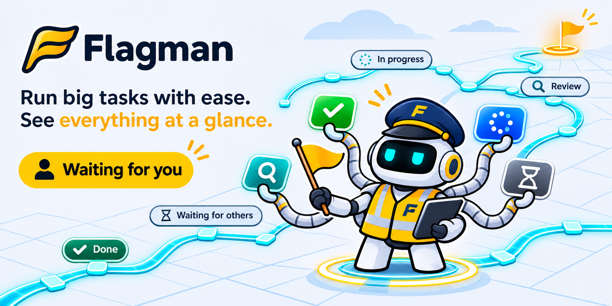
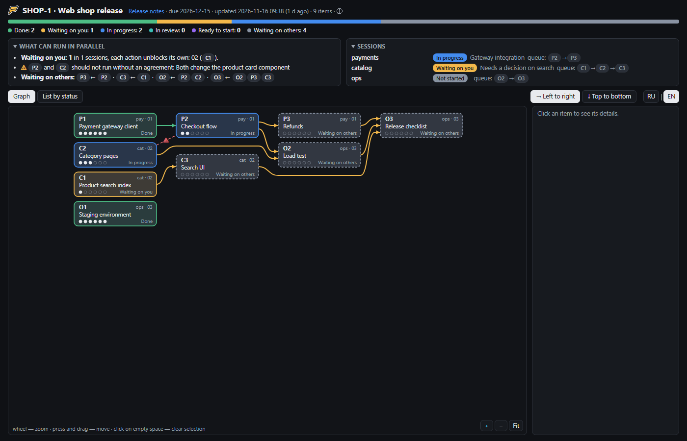

<picture>
  <source media="(prefers-color-scheme: dark)" srcset="docs/brand/banner-dark.png">
  
</picture>

[](https://github.com/makspost5/Flagman/actions/workflows/tests.yml)


**Flagman** is a Claude Code plugin for big tasks split into many items and run by several
Claude sessions at once. It keeps a dependency graph of the items and shows it in a local web
page: what is done, what waits on you, what can run in parallel, and where items conflict.

The name: a flagman is the road worker with a flag who decides who goes now and who waits.



## Quick start

Run these in Claude Code:

```
/plugin marketplace add makspost5/Flagman
/plugin install flagman@flagman
/reload-plugins
```

Then ask Claude:

```
/flagman:graph create a graph for this task
```

Claude creates `taskgraph.js` in the task folder and opens the page. From then on every
session updates its own items with the `fm` command, and the page refreshes by itself.

> Requirements: Python 3.9+ (standard library only), bash (Git Bash on Windows), a browser.
> Tested on Windows, macOS and Linux.

## What you get

- **A graph and a list** of the task items, laid out left-to-right or top-to-bottom, RU/EN.
  The graph orders items to keep arrows from crossing and gives each arrow its own track;
  hover or click an item to light up its dependencies, dependents and conflicts.
- **Stages and statuses** for every item. Stages: plan, code, review, PR, merged, done.
  Statuses: `todo`, `doing`, `wait-me`, `review`, `done`.
- **"Waits on you"** — items with `wait-me` and the exact question for you. The count shows
  in the tab title and on the favicon, so a background tab tells you too.
- **Parallel work** — what is ready to start now and what is blocked, and by what.
- **Conflicts** — pairs of items that touch the same thing.
- **A reminder hook** — when a session edits its `plan.md` or `status.md` (or the files you set), Claude is reminded
  to update the graph with the exact command.

## Try the demo

No install needed, only a clone:

```bash
git clone https://github.com/makspost5/Flagman.git
cd Flagman
bash plugin/bin/fm examples/demo open
```

## Recommended: add to your CLAUDE.md

These lines make every session use the graph without being asked:

```
- If the task folder has a `taskgraph.js`, change item stages and statuses only with the command from
  `/flagman:graph`; do not read or edit the file itself.
- For a task with several parallel sessions, the architect creates the graph (`/flagman:graph`) and puts each
  session's items and the update command into that session's prompt.
```

<details>
<summary>The same in Russian</summary>

```
- Если в папке задачи есть `taskgraph.js`, стадии и статусы пунктов меняй только командой из `/flagman:graph`;
  сам файл не читай и не правь.
- Для задачи с несколькими параллельными сессиями архитектор заводит граф (`/flagman:graph`) и вписывает в
  промпт каждой сессии её пункты и команду обновления.
```

</details>

## Configuration

Optional settings, asked for when the plugin is enabled. All can stay empty.

| Setting | Meaning |
|---|---|
| `tasks_dir` | Folder where task folders live. Empty: `fm` finds the task from the current folder. |
| `lang` | Language of new graphs: `en` or `ru` (stage names, the page's default language). Empty: `en`. |
| `watch_files` | Files whose edits remind a session to update the graph: comma-separated names or globs, matched against the file name without case, e.g. `PROGRESS.md,*.status.md`. Default and empty: `status.md,plan.md`. |

Install the plugin at user level to have it in every session.

## Update and uninstall

```
/plugin marketplace update flagman
/reload-plugins
```

```
/plugin uninstall flagman@flagman
```

## Commands

Claude runs these for you through the `/flagman:graph` skill; you rarely need them by hand.

```
fm [--root DIR] TASK COMMAND [key=value ...]
fm --version
```

`TASK` is a task folder path, or a folder name looked up in the current folder, its parents,
their `.tasks/` folders, and `--root`.

| Command | Meaning |
|---|---|
| `init TITLE [lang=en\|ru] [due=YYYY-MM-DD] [link=LABEL\|HREF]` | create `taskgraph.js`; `lang` sets the stage names, default `en` |
| `import FILE.json` | replace the graph from a JSON file |
| `add ID TITLE [group= session= stage= status= after=A,B summary= wait= detail= file= link=]` | add an item |
| `start ID` | status `doing`; `start`, `next`, `done` and `ask` also take `summary=` |
| `next ID [status=]` | the next stage is finished; status `doing`, or `done` after the last stage |
| `done ID` | status `done`, last stage |
| `ask ID QUESTION` | status `wait-me` with the question for you |
| `set ID [stage= status= wait= summary= title= group= session=]` | change an item, full control |
| `rm ID` | remove an item (refused while something refers to it) |
| `dep ID +DEP -DEPID [note=]` | add or remove dependencies; `DEP` is `ID[@STAGE][:part]` |
| `group ID [title= estimate=]` | create or update a group |
| `session ID [name= dir= state= note= queue=a,b]` | create or update a session |
| `conflict A B WHY` / `conflict A B -` | mark or clear a conflict between two items |
| `show` | short summary: done, waiting on you, in progress, ready, blocked |
| `check` | validate the file (`ok` or a list of problems) |
| `open [--no-browser]` | copy the page next to `taskgraph.js` and open it |
| `--version` (or `version`, without `TASK`) | print the plugin version, `flagman X.Y.Z`; include it in bug reports |

Example:

```
fm SHOP-1 start P2
fm SHOP-1 next P2 summary="cart and checkout written"
fm SHOP-1 ask P2 "pick the payment provider"
```

`fm` is on PATH only inside Claude Code while the plugin is enabled. From your own terminal
run `bash <plugin>/bin/fm`, or `<plugin>\bin\fm.cmd` on Windows.

## How it works

<details>
<summary>The page</summary>

`fm open` writes `taskgraph.html` next to `taskgraph.js` and opens it from `file://`. The page
re-reads the data every few seconds, so it follows `fm` updates. Query parameters:
`?lang=ru|en`, `?dir=lr|tb`, `?tab=graph|list`, `?poll=MS` (refresh interval, at least 200).

While items wait on you, the tab title starts with their count, `(2) Task map SHOP-1 · Flagman`,
and the favicon gets a red badge. The **Notifications** button (off by default, remembered in the
browser) also shows a browser notification when an item starts waiting on you while the page is
not focused.

</details>

<details>
<summary>The reminder hook</summary>

The hook watches edits (`Edit`, `Write`, `MultiEdit`) of files named `status.md` or `plan.md`
(change the list with the `watch_files` setting).
When a session edits one inside a folder that has a `taskgraph.js` (found by walking up from
the file), the hook adds a short reminder to that session's context, once per user prompt.
If the edited path belongs to a session's `dir` in the graph, the reminder lists that
session's items and the exact commands; otherwise it is a neutral reminder:

```
Task graph SHOP-1, session 01 items: P2 code/doing, P3 -/todo. If a stage or status
changed, run: fm "<task folder>" start|next|done <id>, or ask <id> "<what you need from
the user>" (next = the next stage is finished; add status=review when it now waits on others;
anything else: set <id> stage= status=).
Otherwise ignore this.
```

A missing or broken graph makes the hook silent. Errors go to `hook-errors.log` in the plugin
data folder (`~/.flagman` if unset).

</details>

<details>
<summary>Data format</summary>

`taskgraph.js` assigns one JSON object to `window.TASKGRAPH`, so the page can load it with
`<script src>` from `file://`. Only `fm` writes it, atomically.

```
{ "version": 1, "lang": "en",
  "task": { "key", "title", "links": [{label, href}], "due", "updated", "rev" },
  "stages": ["plan", "code", ...],
  "groups": [{ "id", "title", "estimate" }],
  "sessions": [{ "id", "name", "dir", "state", "note", "queue": [item ids] }],
  "items": [{ "id", "title", "group", "session", "stage", "status", "wait",
              "deps": [{ "id", "stage"?, "kind"?, "note" }],
              "summary", "details", "links", "files" }],
  "conflicts": [{ "a", "b", "why" }] }
```

`stage` is an index into `stages` (`-1` = not started); the last stage means done. `stages`
must hold at least 2 unique, non-empty names. Ids are strings; `import` converts numeric ids
to strings. Run `fm TASK check` after importing a hand-made file.

</details>

## Development

Run the tests:

```
py -3 -m unittest discover -s tests -t . -v
```

The page tests use headless Edge or Chrome (set `TASKGRAPH_BROWSER` to pick one) and are
skipped when no browser is found; with `TASKGRAPH_REQUIRE_BROWSER=1`, as in CI, a missing
browser is a failure. CI runs the tests on Windows, macOS and Ubuntu with Python 3.9 and 3.13.

<details>
<summary>Notes for maintainers on Windows</summary>

- A commit made on Windows stores `plugin/bin/fm` and `plugin/scripts/hook` without the
  executable bit. After `git add`, run
  `git update-index --chmod=+x plugin/bin/fm plugin/scripts/hook`.
- On macOS and Linux the reminder runs `bash "<plugin>/bin/fm" ...` and the hook starts through
  `bash`, so the bit does not matter there.
- On Windows the reminder says plain `fm`: the Bash tool runs `bin/fm`, the PowerShell tool runs
  `bin/fm.cmd` (PowerShell cannot run an extensionless file, and `bash` in PowerShell is WSL).
  Keep `bin/fm.cmd` with CRLF line endings (`.gitattributes` does this).

</details>

## Brand

The mark: `docs/brand/flagman-mark.svg` for light backgrounds and
`docs/brand/flagman-mark-sticker.svg` (with a white outline) for dark ones. The banner and
the mascot are in the same folder.

## License

[MIT](LICENSE)
